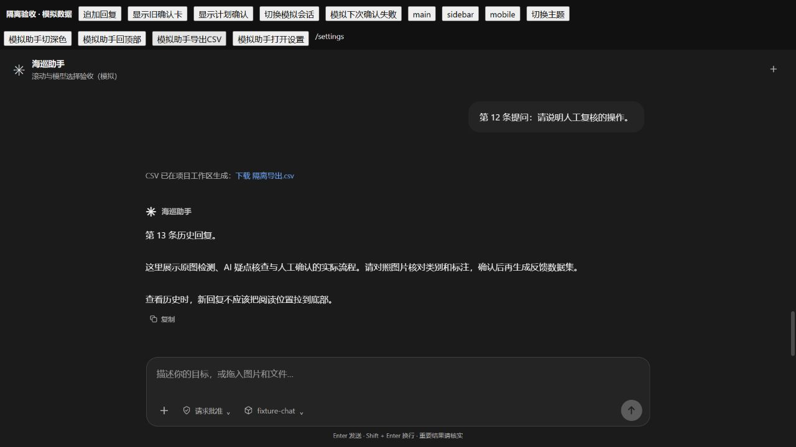

# INT-41：项目/会话、CSV、资料、手册与界面接入内部Agent

实施：Codex。版本：海巡智检v1.1。仅修改此版本代码，保留原人工入口，不推送GitHub。

## 用户需求

让网站内部OpenCode调用原有管理与界面能力，补齐上次覆盖复核列出的缺项；不以外部Agent代替内部闭环。

## 实现

新增`agent/workspace_tools.py`，注册10个工具到`OpenCodeRuntime`：

| 工具 | 实际作用 |
|---|---|
| workspace_projects | 本人项目和项目回收站 |
| workspace_manage_project | 创建、改名、说明/要求、首次绑定目录、软删除和恢复 |
| workspace_sessions | 本人会话列表/搜索、回收站、按offset分页读取user/assistant历史 |
| workspace_manage_session | 新建、改名、软删除、恢复 |
| workspace_switch_context | 发送明确项目/会话切换事件，不迁移原任务 |
| workspace_export_records_csv | 指定页50条再按页面规则筛选；五列CSV、UTF8 BOM、公式转义，输出工作区exports并登记受保护附件 |
| workspace_documents | 当前项目资料列表、分页原文块、打开原文件 |
| workspace_manuals | 列出/读取内置与本人手册 |
| workspace_manage_manual | 创建/更新个人手册、为本人会话选择固定版本 |
| workspace_ui | 主题、业务页助手右栏、对话滚动、复制本会话消息、打开设置、重播引导 |

管理工具复用`permissions`、`sessions`、`recycle`、`manuals`，资料复用`document_service`和鉴权文件服务。新加`read_history`及`read_document_blocks`共享读取函数，原文预览HTTP路由为`GET /api/agent/documents/<id>/preview?offset=0&limit=20`。

前端`AgentProgress`处理来自当前项目/会话的新事件，异步返回后再次核对上下文，防止旧消息控制新会话。`DocumentLibrary`能按助手指定资料ID打开原文；PDF嵌入原件、Word展示解析段落/表格并可下载原件。解析资料后的资源事件会刷新列表。

CSV结果在对话中提供可点击下载链接，浏览器不会被后台程序反复触发下载。生成文件已位于工作区；页面下载只是取回副本。若刷新后链接已失效，可从工作区exports取文件或重新发起导出。

## 确认与删除

- 查询、资料读取、界面请求不改业务真值；assist/full内置CSV导出按已授权策略执行，request模式保留卡片。
- 项目/会话写操作、目录绑定、手册修改/选择使用具体确认卡。Key、MCP连接、权限模式不能由模型自行变更。
- 目录绑定复用原本机管理员校验；只首次绑定，已有绑定不直接更换。项目要求和手册不能扩大权限。
- 删除当前项目/会话只移入回收站，保留文件/历史；允许排除发起删除的这个任务，但其他执行中任务和训练保护仍有效。
- 当前上下文删除后立即停止后续模型步骤；运行时返回真实结果，前端退出已删除上下文。重复确认复用结果。
- 软删除使所属待批准动作失效，恢复不会意外执行旧卡；清理相应OpenCode引擎。
- 确认卡实际目标由本进程provider解析，支持本人已删除项目的恢复，不把跨项目会话修改误写成当前聊天项目。

## 验证

1. 完整后端：`python -m pytest -q --tb=short`，524 passed、20 skipped、38 subtests passed；271秒。既有JWT测试短密钥和依赖弃用警告4项。
2. 后续定向：`test_workspace_tools.py test_agent_backend.py test_business_approval_modes.py test_project_agent_extensions.py`，53 passed、10 subtests passed。
3. 最后增加历史分页及管理保护后：`test_workspace_tools.py`，13 passed。以上计数不能相加当作一次完整回归。
4. 前端：`node --test tests/*.test.mjs`，29 passed；`vue-tsc --noEmit`与`vite build`通过。并发Vite测试提示HMR端口已占用，但测试全部成功。
5. 浏览器`/tests/chat-ui.html`使用模拟资料/消息验证：主题实际为dark；回到顶部实际scrollTop=0；设置路由为/settings；CSV结果出现可下载链接。第一次等待自动下载事件超时，因此改为明确结果链接，不宣称已验证浏览器自动保存。
6. 手册变更后的页面自动刷新补齐后，手册定向1 passed；再次类型检查与生产构建通过。最终检查无活动Agent/训练任务后重启已核实路径的v1.1后端，`/api/health/health_check`及前端5173均返回200。

所有写操作测试使用临时项目、数据库和文件；未删除真实项目/会话，未调用真实模型、未进行训练。真实业务数据库已备份到版本根目录`备份/INT-41-20261029-222129/yyxz_sqlite.db`，不在Git目录内。

## 可直接测试的提问

- 列出我的项目，把当前项目改名为“热斑复核”。
- 在当前项目新建一个名为“第二轮巡检”的会话。
- 查找这个项目的历史会话，打开我指定的会话。
- 导出本项目第1页已完成的识别记录CSV。
- 列出本项目资料，打开这份PDF原文，按段读这份Word。
- 创建“红外配对检查”个人手册，内容如下……；为这个会话选择该手册。
- 切换深色主题，回到对话顶部，打开设置，重新播放使用引导。

## 尚不扩大承诺

这轮覆盖的是以上明确命令，不是所有浏览器组件。API Key、MCP连接、权限放宽及所有下拉框不交给模型任意操作；真实图像真值仍由人确认。会话搜索范围为最近200会话；指定会话历史支持分页。没有用真实付费模型做全量自然语言命中率验收。
